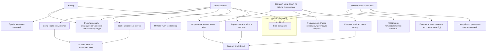
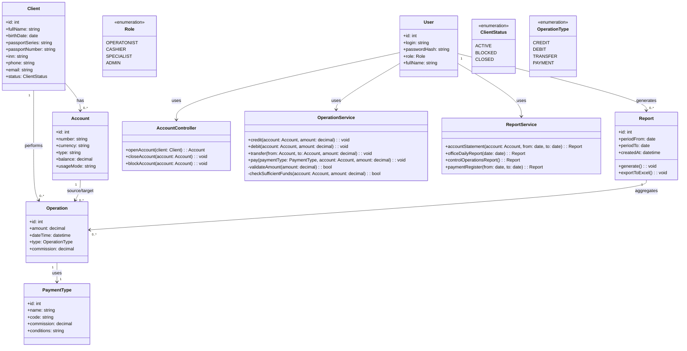
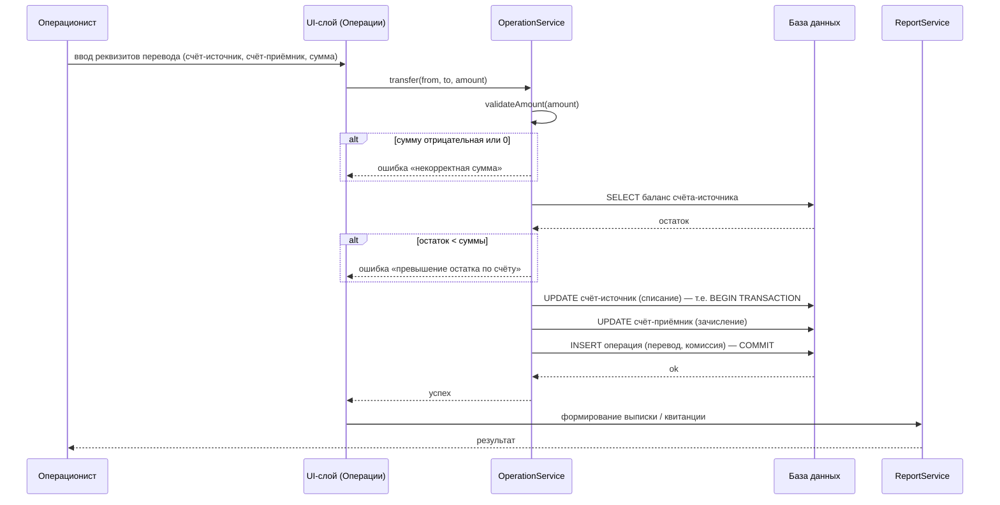
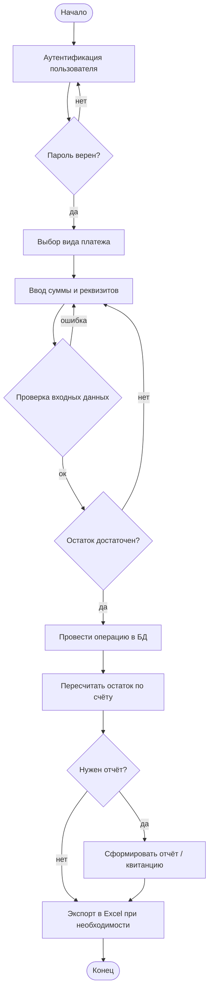
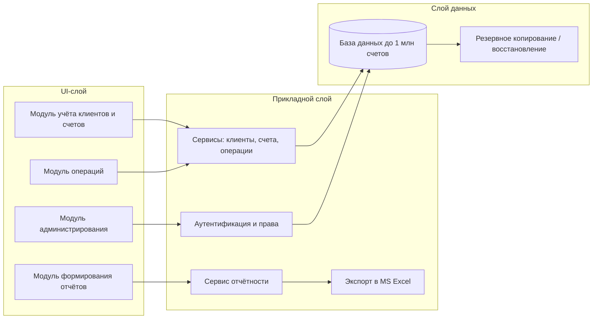
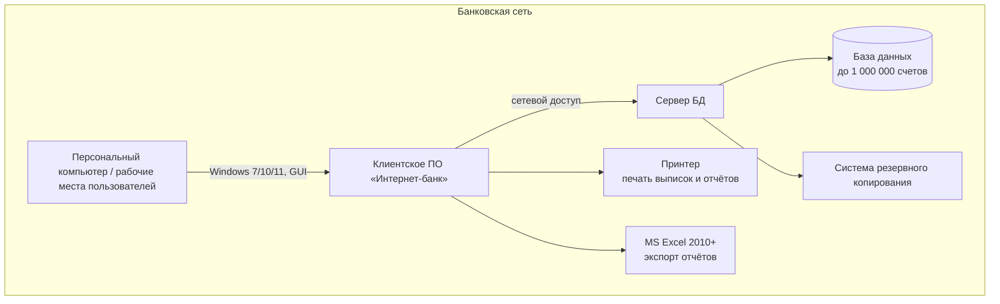

# UML-диаграммы — «Интернет-банк для физических лиц»

По ТЗ из README репозитория. Диаграммы написаны на Mermaid (rendering в VSCode, GitHub, Mermaid Live Editor и т.п.).

---

## 1. Диаграмма вариантов использования (Use Case)

---

## 2. Диаграмма классов (Class)

---

## 3. Диаграмма последовательности — перевод между счетами (Sequence)

---

## 4. Диаграмма деятельности — приём платежа (Activity)

---

## 5. Диаграмма компонентов (Component)

---

## 6. Диаграмма развёртывания (Deployment)

---

### Замечания
- Диаграммы построены по тексту ТЗ и описывают **логику из документа**, без привязки к фактическому коду (в README его нет).
- Точные атрибуты сущностей (поля классов) уточняются по образцам входных/выходных документов из Приложений 1–3 ТЗ.